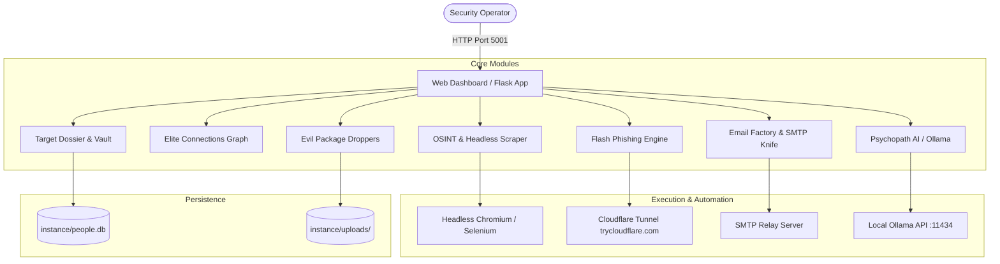

# 🧠 PSYCHOPATH CONSOLE

<p align="center">
  
  
  
  
  
</p>

<p align="center">
  <strong>An Advanced All-In-One Threat Emulation, OSINT Reconnaissance, and Social Engineering Framework</strong><br>
  Architected and Developed by <a href="https://github.com/chadi0x"><strong>chadi0x</strong></a>
</p>

---

> ### ⚠️ STRICT LEGAL DISCLAIMER & EDUCATIONAL USE POLICY
> **THIS SOFTWARE IS PROVIDED SOLELY FOR AUTHORIZED SECURITY TESTING, EDUCATIONAL RESEARCH, AND DEFENSIVE SYSTEM HARDENING.**
> 
> * The author and creator (**[chadi0x](https://github.com/chadi0x)**) explicitly disclaims any and all responsibility, legal liability, and accountability for damages, system downtime, unauthorized intrusions, or illicit activities resulting from the use or misuse of this tool.
> * Deploying these modules against targets without explicit, documented, prior written permission from the target system owner is strictly illegal under international cyber law (including the Computer Fraud and Abuse Act and relevant penal codes).
> * By downloading, running, or reviewing this code, you commit to utilizing it purely within ethical and authorized security environments.

---

## 📸 Screenshots Showcase

<!-- Replace the placeholder paths below with your actual screenshots stored in docs/screenshots/ -->

| 🖥️ Main Dashboard & Target Dossiers | 🕸️ Elite Connections Relational Graph |
| :---: | :---: |
|  <br> *Target Dossier Management & Live Vault* |  <br> *Dynamic Vis.js Relational Mind Map* |

| 🛰️ OSINT Intelligence & Image Recon | ⚡ Flash Phishing Multi-Platform Portal |
| :---: | :---: |
|  <br> *Automated Footprinting & Headless Scraper* |  <br> *30+ Turnkey Cloned Portals with Tunneling* |

| 📦 Evil Package Factory & Lures | 🔪 SMTP Knife & Credential Vault |
| :---: | :---: |
|  <br> *Multi-OS Lure Landing Page Generator* |  <br> *Direct Relay Delivery & Verification* |

| 🤖 Psychopath AI Social Engineering | 📊 Live Harvest & Analytics Feed |
| :---: | :---: |
|  <br> *Pretexting & Scenario Brainstorming* |  <br> *Real-time IP Tracker & Geolocation Map* |

---

## 🌟 Key Highlights & Philosophy

**Psychopath Console** is an integrated adversary emulation operations platform designed to simulate modern red-team campaigns end-to-end. Rather than cobbling together disparate scripts, Psychopath Console centralizes:

1. **Target profiling & dossier organization**
2. **Open-source intelligence (OSINT) footprinting**
3. **Multi-scenario pretext crafting & phishing deployment**
4. **Interactive relation mind-mapping**
5. **Real-time payload delivery with auto-tunneling**
6. **Instant global kill-switch controls**

---

## 🧰 Comprehensive Tool Directory

### 1. 🗂️ Target Database & Dossier Vault (`/`)
* **Comprehensive Profiling:** Store targets with full names, occupations, contact emails, sticky operational notes, country of origin, and discovered IP addresses.
* **Encrypted Credential Vault:** Secure storage for harvested social account logins and credentials per target with quick-copy utilities.
* **Dynamic Avatars:** Automatically generates customized UI avatars or integrates discovered profile images.
* **Full CRUD Operations:** Rapidly create, edit, search, and delete targets with real-time modal previews.

### 2. 🕸️ Elite Connections - Relational Mind Map (`/connections`)
* **Interactive Graph Engine:** Visual representation powered by Vis.js to map connections between targets, organizations, aliases, and assets.
* **Physics & Layouts:** Switch effortlessly between force-directed and hierarchical layouts.
* **Canvas Sticky Notes:** Attach tactical annotations, timestamps, and investigation cues directly onto the diagram.
* **Persistent Layout Storage:** Save custom node placements to the backend database for collaborative review.

### 3. 🛰️ Intelligence Hub (OSINT Engine) (`/osint`)
* **Google Dork Generator & Search:** Pre-configured and custom search syntax for discovering email leaks, social media presence, and sensitive docs.
* **Automated Profile Image Scraper:** Runs headless Chromium through Selenium to fetch and cache candidate profile images from Bing and Google Images.
* **Target Association:** Associate discovered images and data directly to existing target cards with one click.

### 4. 📈 Real-Time IP Logger & Geolocation Tracker (`/logs`, `/track/<id>`)
* **Lure Link Creation:** Generate masked tracking URLs with customized destination redirect targets.
* **Detailed Capture:** Log visitor IP address, user-agent string, device type, ISP, country, city, and timestamp.
* **Free Geo-IP Integration:** Utilizes IP-API data for geographical insights without requiring proprietary API subscriptions.

### 5. ☣️ Evil Package Factory (`/evil`)
* **Multi-Platform Dropper Simulation:** Upload and serve payloads tailored for Windows (`.exe`, `.bat`), Linux (`.deb`, `.sh`), and Android (`.apk`).
* **Realistic Lure Landing Pages:**
  * 📈 **Trading Platform**: Imitates financial trading software downloads.
  * 📶 **WiFi Captive Portal**: Imitates network authentication and driver installers.
  * 🛡️ **Software Verification**: Imitates mandatory security verification executables.
* **UUID Isolation:** Each generated lure has a unique identifier and direct download tracking endpoint.

### 6. ✉️ Email Factory (`/email_factory`)
* **Spear-Phishing Pretext Builder:** Library of pre-formatted, persuasive phishing and notification templates.
* **Dynamic Variable Tagging:** Automatically inject target variables such as `{name}`, `{email}`, `{company}`, and `{link}` into the payload body.
* **Real-time Live HTML Preview:** Instantly preview desktop and mobile renders of crafted phishing emails.
* **Direct Hand-off:** Export crafted templates straight into the SMTP Knife delivery tool.

### 7. 🔪 SMTP Knife & Credential Vault (`/smtp_knife`, `/smtp_credentials`)
* **Direct SMTP Relay:** Send HTML or plain-text spear-phishing messages using app-passwords or custom relays.
* **Live Connection Tester:** Test SMTP credentials and TLS/SSL configurations on ports 465 and 587 in real-time.
* **Credential Vault:** Save and manage multiple sending relays securely.
* **Custom Spoofed Display:** Configure sender display names, reply-to headers, and customized subject lines.

### 8. 🤖 Psychopath AI Assistant (`/psychopath_ai`)
* **Integrated LLM Operations:** Built-in connection to local LLMs (via Ollama on port 11434, e.g., `mistral`, `llama3`, `llama2-uncensored`).
* **Specialized Pretexting:** Brainstorm realistic social engineering scenarios, craft spear-phishing pretexts, and generate OSINT search strategies.
* **Session Management:** Multi-conversation chat history with instant session creation and cleanup.

### 9. ⚡ Flash Phishing Engine (`/flash_phishing`, `/flash_data`)
* **30+ Cloned Enterprise Templates:** Turnkey login clones for Google, Microsoft 365, Facebook, Instagram, LinkedIn, Netflix, Steam, PayPal, Discord, Twitter/X, Apple ID, Amazon, GitHub, Proton, Spotify, and more.
* **Multi-Language Support:** English, French, and Arabic right-to-left (RTL) login localization.
* **Automated Cloudflare Tunnel Integration:** Automatically discovers and binds to `trycloudflare.com` public URLs for instant external access without manual port forwarding.
* **Credential Harvester:** Real-time logging of submitted credentials, victim IP, user-agent, and immediate redirect to legitimate platforms to avoid suspicion.
* **🚨 Emergency Global Kill Switch:** Instantly terminates all active Flash links, kills active Cloudflare tunnels, and closes incoming traffic with one click.

### 10. 👤 Developer Profile & Integrity Hub (`/developer`)
* Interactive developer dossier showcasing project architecture, author contact details, repository links, and comprehensive educational disclaimers.

---

## 🏛️ System Architecture



---

## 🚀 Quick Start Deployment

### Method 1: Docker Compose (Recommended)

1. **Clone the repository:**
   ```bash
   git clone https://github.com/chadi0x/psychopath-console.git
   cd psychopath-console
   ```

2. **Launch via the automated script:**
   ```bash
   chmod +x run.sh
   ./run.sh
   ```
   *Or launch directly with Docker Compose:*
   ```bash
   docker-compose up --build -d
   ```

3. **Access the Console:**
   * Open your browser and navigate to: **`http://localhost:5001`**
   * (If running on a remote VPS, navigate to: `http://<YOUR_VPS_IP>:5001`)

---

### Method 2: Manual Local Setup (Python 3.9+)

1. **Install system prerequisites:**
   * **Linux (Debian/Ubuntu):**
     ```bash
     sudo apt-get update
     sudo apt-get install -y chromium chromium-driver python3 python3-pip python3-venv
     ```
   * **macOS:**
     ```bash
     brew install chromium chromedriver python3
     ```
   * **Windows:**
     Ensure Python 3.9+ and Google Chrome are installed with `chromedriver` added to your system `PATH`.

2. **Create a virtual environment & install requirements:**
   ```bash
   python3 -m venv venv
   source venv/bin/activate  # On Windows: .\venv\Scripts\activate
   pip install -r requirements.txt
   ```

3. **Run the server:**
   ```bash
   python3 app.py
   ```
   *The console will be accessible on `http://127.0.0.1:5000`.*

---

## 📁 Repository File Structure

```text
├── app.py                      # Core Flask backend, models, routing & APIs
├── requirements.txt            # Python dependencies (Flask, SQLAlchemy, Selenium, etc.)
├── Dockerfile                  # Container definition with Chromium headless support
├── docker-compose.yml          # Container orchestration and persistent volume mapping
├── run.sh                      # Automated bootstrapper and Cloudflare tunnel extractor
├── export_image.sh             # Docker golden image export utility
├── verify_flash.py             # Unit verification script for Flash templates
├── instance/                   # Runtime volume (Database, uploaded files)
│   ├── uploads/                # Dropper payloads and stored attachments
│   └── .gitkeep
├── docs/
│   └── screenshots/            # Graphical documentation and showcase images
│       └── .gitkeep
├── static/
│   ├── script.js               # Frontend interactions & Integrity Guardian
│   ├── style.css               # Cyberpunk dark theme & layout stylesheets
│   ├── bootstrap_overrides.css # Custom component styling
│   ├── extensions.css          # Auxiliary styling rules
│   └── modal_style.css         # Target dossier modal stylesheet
└── templates/
    ├── base.html               # Master layout with sidebar & author watermarks
    ├── developer.html          # Author dossier, profile & educational disclaimer
    ├── index.html              # Target dossier dashboard
    ├── connections.html        # Relational Vis.js mind-map
    ├── osint.html              # OSINT dorking & automated image scraping
    ├── logger_list.html        # Tracking link management
    ├── stats.html              # Real-time IP tracker statistics
    ├── evil_dashboard.html     # Evil Package lure generator
    ├── email_factory.html      # Spear-phishing email builder
    ├── smtp_knife.html         # SMTP relay execution engine
    ├── smtp_credentials.html   # SMTP key & server manager
    ├── ai_chat.html            # Psychopath AI operational assistant
    ├── flash_phishing.html     # Flash Phishing deployer
    ├── flash_data.html         # Harvested credential live monitor
    ├── flash/
    │   └── universal_login.html# 30+ platform phishing template engine
    └── phishing/
        ├── trading.html        # Trading software lure
        ├── verify.html         # Verification software lure
        └── wifi.html           # Captive WiFi lure
```

---

## 🛠️ Configuration & Customization

| Configuration Key | Location | Description | Default |
| :--- | :--- | :--- | :--- |
| `SECRET_KEY` | `app.py` | Flask session encryption key | `'your-secret-key-change-me'` |
| `SQLALCHEMY_DATABASE_URI` | `app.py` | SQLite database storage path | `'sqlite:///instance/people.db'` |
| `FLASH_PLATFORMS` | `app.py` | Platform configurations (logos, CSS, fields) | 30+ major platforms |
| Ollama Host | `templates/ai_chat.html` | Endpoint for local LLM requests | `http://localhost:11434` |
| Cloudflare Tunnel | `run.sh` / `instance/tunnel_url.txt` | Auto-detected tunnel domain | Generated on boot |

---

## 🔄 Resetting / Cleaning Data

To completely wipe all target dossiers, uploaded payloads, and logs to return to a clean install state:

```bash
# 1. Stop active containers
docker-compose down

# 2. Delete database and uploads (Linux / macOS)
rm -f instance/people.db instance/tunnel_url.txt instance/uploads/*

# Or on Windows PowerShell:
Remove-Item instance/people.db, instance/tunnel_url.txt, instance/uploads/* -Force

# 3. Restart clean container
docker-compose up -d
```

---

## 👨‍💻 Creator & Credits

* **Core Architect & Developer:** **chadi0x**
* **Official GitHub Profile:** [https://github.com/chadi0x](https://github.com/chadi0x)
* **Project Name:** Psychopath Console (v2.5)
* **Contributions & Support:** Found a bug or have an educational feature suggestion? Feel free to open an Issue or Pull Request on the [GitHub Repository](https://github.com/chadi0x).

---

<p align="center">
  <sub>Developed with 💻 and ☕ by <a href="https://github.com/chadi0x"><strong>chadi0x</strong></a>. Strictly for authorized educational & security research use.</sub>
</p>
